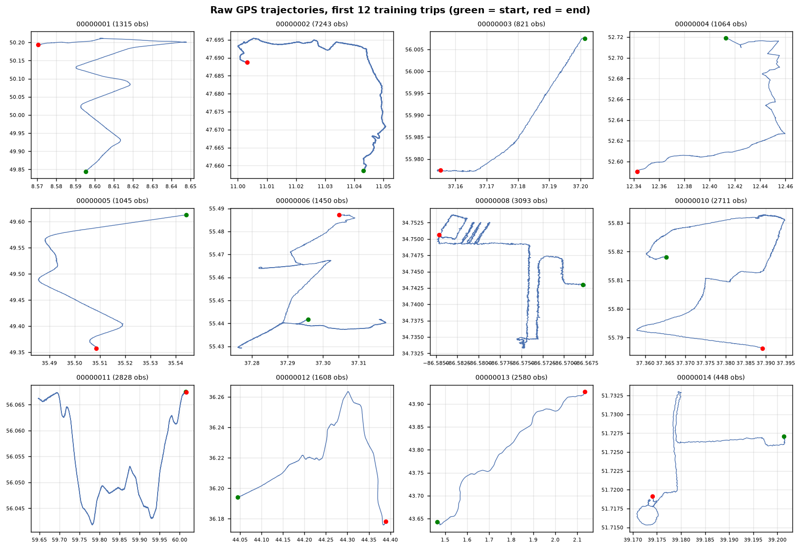
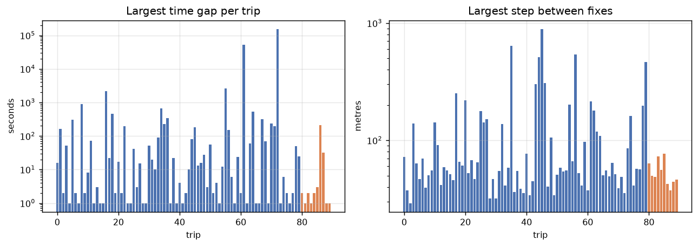
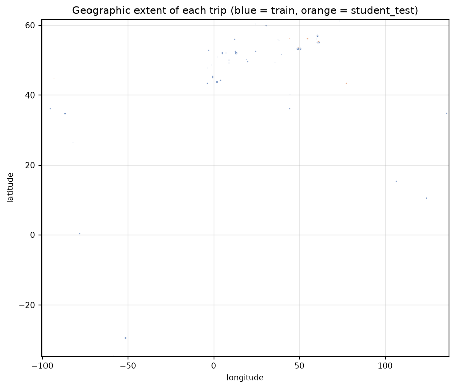
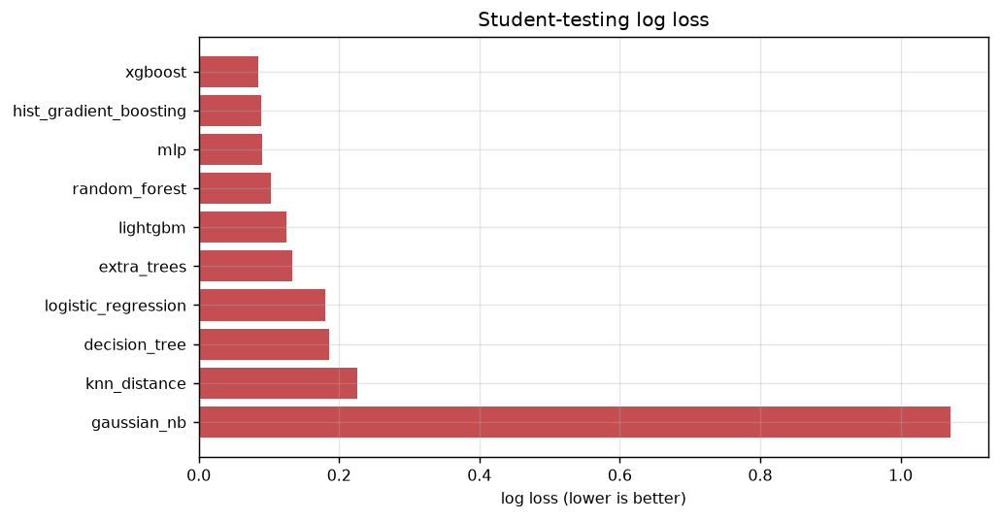
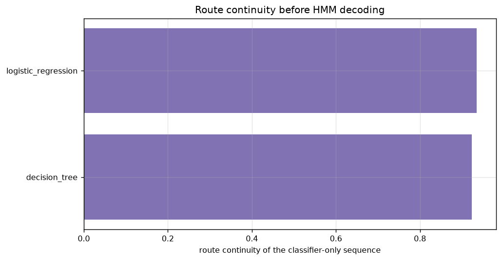
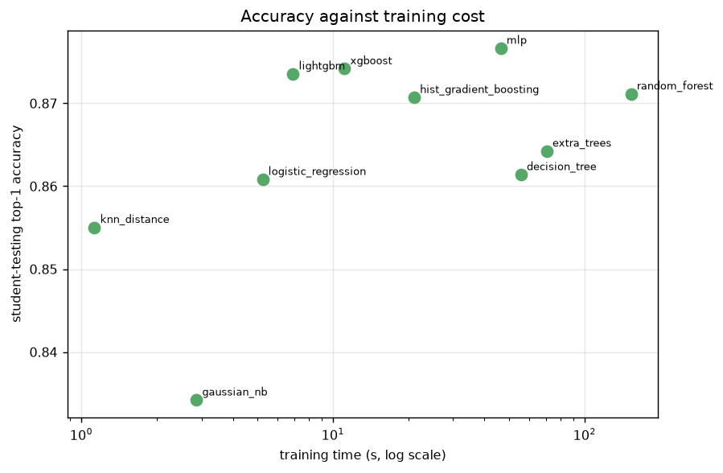
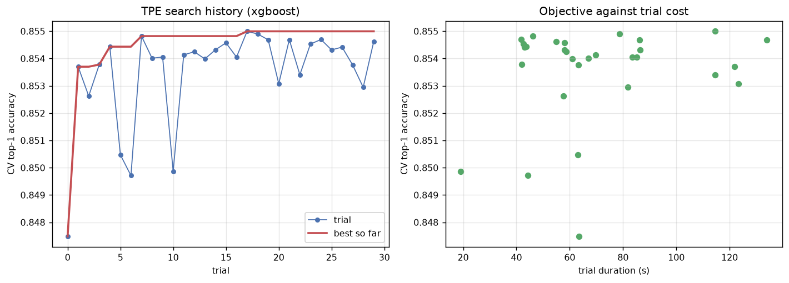
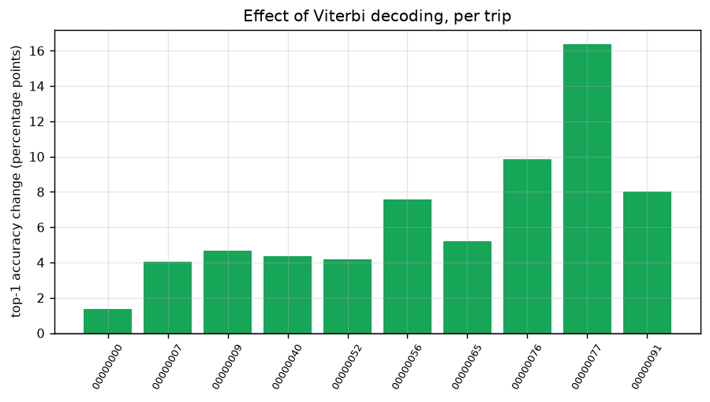
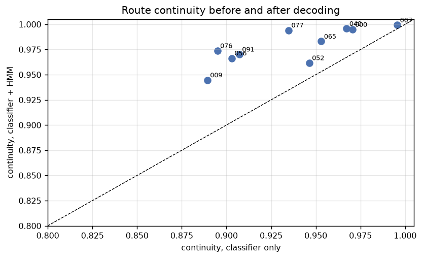

# PathSnap — Technical Report

**UE24CS352A Machine Learning Hackathon · PES University, Department of CSE (RR Campus)**

Team: _______________  ·  Members: _______________  ·  Generated: 2026-11-18

Repository: https://github.com/rishaandeen-sys/PathSnap

---

> **How to use this file.** Every table and figure below is filled in automatically from the CSVs in `results/`, so the numbers match the experiments exactly. The blocks marked **TEAM ANALYSIS REQUIRED** are deliberately empty — write those in your own words, then export this file to PDF.

---

## 2. Dataset Understanding and Exploratory Data Analysis

### 2.1 Partition summary

| partition    |   n_trips |   total_observations |   obs_per_trip_mean |   obs_per_trip_min |   obs_per_trip_max |   total_track_km |   mean_speed_kmh |   frac_dt_eq_1s |   trips_with_gaps |   mean_arcs |   label_residual_median_m |
|:-------------|----------:|---------------------:|--------------------:|-------------------:|-------------------:|-----------------:|-----------------:|----------------:|------------------:|------------:|--------------------------:|
| student_test |        10 |                19160 |             1916    |                262 |               3958 |          296.968 |           53.527 |           0.982 |                 2 |     18504.1 |                     4.745 |
| train        |        80 |               208417 |             2605.21 |                361 |              19313 |         2978.41  |           48.6   |           0.938 |                45 |     48461.3 |                     4.629 |

### 2.2 Data-quality checks

|                                 |   train |   student_test |
|:--------------------------------|--------:|---------------:|
| total_observations              |  208417 |          19160 |
| nan_values_in_track             |       0 |              0 |
| duplicate_timestamps            |       0 |              0 |
| non_increasing_timestamps       |       0 |              0 |
| coordinates_out_of_range        |       0 |              0 |
| consecutive_identical_positions |       6 |              0 |
| self_loop_arcs                  |      22 |              2 |
| arcs_with_invalid_node_id       |       0 |              0 |
| zero_length_arcs                |     100 |              6 |
| route_arc_ids_out_of_range      |       0 |              0 |

### 2.3 Candidate generation

| partition    |   n_trips |   n_observations |   n_candidate_rows |   mean_candidates_per_obs |   n_observations_reliably_labelled |   frac_observations_reliably_labelled |   label_residual_max_m |   candidate_miss_rate |   candidate_miss_rate_all_obs |   positive_rate |   median_label_residual_m |   build_seconds |   radius_m |   max_candidates |
|:-------------|----------:|-----------------:|-------------------:|--------------------------:|-----------------------------------:|--------------------------------------:|-----------------------:|----------------------:|------------------------------:|----------------:|--------------------------:|----------------:|-----------:|-----------------:|
| train        |        80 |           208415 |            1497156 |                   7.18353 |                             182351 |                               0.87494 |                     30 |               0.00262 |                       0.07742 |         0.12843 |                   5.9081  |        38.9883  |         60 |               10 |
| student_test |        10 |            19160 |             140908 |                   7.35428 |                              19013 |                               0.99233 |                     30 |               0.00084 |                       0.00256 |         0.13563 |                   5.23226 |         3.27683 |         60 |               10 |


The candidate miss rate of **0.2616%** on reliably-labelled training observations is the hard ceiling on top-1 accuracy: an observation whose reference arc was never retrieved cannot be classified correctly by any model.


**Label reliability.** 87.49% of training observations have a reference arc within 30 m. The remainder come from trips whose supplied `.route` covers only part of the GPS track and are excluded from fitting and scoring.

### 2.4 Preprocessing

- Local equirectangular projection to metres, centred per trip.
- Per-observation reference arc recovered by monotonic DP alignment against the `.route` sequence.
- Observations whose aligned arc is further than 30 m away flagged and excluded.
- Candidates: arcs within 60 m, nearest 10 kept.
- Median imputation for the neighbour-dependent features at the first and last fix; standardisation for the distance- and gradient-based models only.


> **TEAM ANALYSIS REQUIRED — write this yourself:**
> - How did you preprocess the data, and why those choices?
> - What patterns did you see during exploration?
> - Which features did you extract and why those?
> - Which partition was used for each analysis?


*Dataset overview*




*Raw GPS trajectories, first 12 training trips*




*Sampling gaps and step sizes per trip*




*Geographic extent of every trip*


**Folium map:** `results/maps/eda_trip_*.html` — include a screenshot here.


---

## 3. Model Experimentation and Comparison

### 3.1 Overall model comparison

| model               | algorithm_family       | key_configuration                                 |   cv_macro_f1_mean |   test_top1_accuracy |   test_route_continuity |   test_macro_f1 |   test_log_loss |   inference_seconds |
|:--------------------|:-----------------------|:--------------------------------------------------|-------------------:|---------------------:|------------------------:|----------------:|----------------:|--------------------:|
| decision_tree       | Tree-based             | gini, max_depth=14, min_samples_leaf=50, balanced |             0.8793 |               0.8614 |                  0.9231 |          0.8842 |          0.1855 |              0.1008 |
| logistic_regression | Linear / probabilistic | lbfgs, C=1.0, class_weight=balanced, standardised |             0.872  |               0.8608 |                  0.9345 |          0.8765 |          0.1802 |              0.1056 |


2 models were trained and compared, spanning 2 algorithm families. Cross-validation is `GroupKFold(5)` grouped by trip, so no trip is split across folds.


### 3.2 Per-fold scores

| model               |      1 |      2 |      3 |      4 |      5 |
|:--------------------|-------:|-------:|-------:|-------:|-------:|
| decision_tree       | 0.8758 | 0.8802 | 0.9083 | 0.8679 | 0.864  |
| logistic_regression | 0.8703 | 0.8727 | 0.8999 | 0.8578 | 0.8593 |


*Cross-validation macro F1 across all models*


*Student-testing top-1 accuracy and macro F1*




*Student-testing log loss*


*Per-fold stability*




*Route continuity before HMM decoding*




*Accuracy against training cost*


### 3.3 Per-model questions


#### decision_tree — Tree-based

Configuration: `gini, max_depth=14, min_samples_leaf=50, balanced`


| metric | value |
|---|---|
| CV macro F1 | 0.8793 ± 0.0156 |
| CV top-1 accuracy | 0.8492 |
| Student-test top-1 accuracy | 0.8614 |
| Student-test macro F1 | 0.8842 |
| Student-test precision / recall (macro) | 0.8456 / 0.9424 |
| Student-test log loss | 0.1855 |
| Route continuity | 0.9231 |
| Train / inference time (s) | 74.3 / 0.10 |


> **TEAM ANALYSIS REQUIRED — write this yourself:**
> - Why is decision_tree suitable for the PathSnap problem?
> - What are its strengths and limitations *for this task*?
> - Which hyperparameters mattered, and what were their initial values?
> - What loss or optimisation objective does it use?
> - Did you observe overfitting or underfitting? What is the evidence (compare the CV and student-test columns above)?


#### logistic_regression — Linear / probabilistic

Configuration: `lbfgs, C=1.0, class_weight=balanced, standardised`


| metric | value |
|---|---|
| CV macro F1 | 0.8720 ± 0.0151 |
| CV top-1 accuracy | 0.8539 |
| Student-test top-1 accuracy | 0.8608 |
| Student-test macro F1 | 0.8765 |
| Student-test precision / recall (macro) | 0.8370 / 0.9378 |
| Student-test log loss | 0.1802 |
| Route continuity | 0.9345 |
| Train / inference time (s) | 16.9 / 0.11 |


> **TEAM ANALYSIS REQUIRED — write this yourself:**
> - Why is logistic_regression suitable for the PathSnap problem?
> - What are its strengths and limitations *for this task*?
> - Which hyperparameters mattered, and what were their initial values?
> - What loss or optimisation objective does it use?
> - Did you observe overfitting or underfitting? What is the evidence (compare the CV and student-test columns above)?


---

## 4. Bayesian Hyperparameter Optimisation




*TPE search history*


*Objective against each searched hyperparameter*


*Tuned vs untuned*


> **TEAM ANALYSIS REQUIRED — write this yourself:**
> - Which hyperparameters did you search, and why those?
> - What ranges/distributions did you choose, and on what grounds?
> - Did the tuned model beat the untuned one? By how much, and is the gap larger than the fold-to-fold variation?
> - What did the search cost, and was it worth it?


---

## 5. HMM and Viterbi Route Reconstruction


- **Hidden states:** the candidate arcs of each observation — a lattice whose state space changes per step, not a fixed alphabet.
- **Emissions:** classifier scores, normalised over each observation's candidates.
- **Transitions:** `P(j|i) ∝ exp(-|d_route - d_gps| / beta)`, with `d_route` the on-road travel distance via bounded Dijkstra (Newson & Krumm, 2009).
- **Unreachable pairs:** fixed penalty rather than prohibition, so the lattice can never dead-end.
- **GPS gaps:** above 5 s the search radius grows and beta is relaxed.
- **Route expansion:** intermediate arcs the vehicle crossed between fixes are filled in by shortest path, turning per-observation decisions into a drivable route.


*Top-1 accuracy and continuity per trip*




*Effect of Viterbi decoding per trip*




*Continuity before and after decoding*


*Decoder parameter search on training trips*


> **TEAM ANALYSIS REQUIRED — write this yourself:**
> - What are the hidden states in your implementation?
> - How are emission probabilities calculated?
> - How are transition probabilities calculated?
> - How are missing candidates and large GPS gaps handled?
> - What happens when consecutive observations suggest disconnected segments?
> - Did decoding improve the route? Where did it NOT help, and why?


---

## 6. Geographical Visualisation Using Folium


Interactive maps: `results/maps/index.html`. Each map carries toggleable layers for the road network, raw GPS observations, the reference route, the classifier-only route and the predicted route, with a legend and layer control.


> **TEAM ANALYSIS REQUIRED — write this yourself:**
> - Insert at least one map screenshot and describe what it shows: where the raw GPS drifts off-road and how the predicted route recovers it.


---

## 7. API, UI and Deployment

**Laptop 1 (model + API)**

```bash
set PATHSNAP_EVAL_DIR=...\evaluator_test
uvicorn api.main:app --host 0.0.0.0 --port 8000
```


**Laptop 2 (evaluator UI)**

```bash
streamlit run ui/app.py
```


| Endpoint | Purpose |
|---|---|
| `GET /health` | model, decoder config, trip count |
| `GET /trips` | the ten evaluation trips |
| `POST /predict` | run the pipeline, return route + server-side metrics |
| `GET /network/{trip_id}` | road-network geometry for map context |
| `GET /logs` | recent requests |


**Evaluation integrity.** The reference route is read only inside `/predict`, after prediction, and only to compute accuracy. It is never passed to the matcher and is omitted from the response unless explicitly requested. Nothing is hardcoded per trip.


> **TEAM ANALYSIS REQUIRED — write this yourself:**
> - Insert screenshots of the working UI.
> - Insert a screenshot of the API logs on Laptop 1 showing the evaluator's requests arriving.


---

## 8. Academic Integrity and AI Use


> **TEAM ANALYSIS REQUIRED — write this yourself:**
> - State which parts were AI-assisted and which were the team's own work, as the event's policy requires.
> - Confirm every member can explain the code, experiments and results.


---

## Appendix: reproducibility

- Seed: `42`, folds: `5`
- Features (26): `dist_m, dist_rank, dist_minus_best, dist_ratio_best, dist_z_in_obs, n_candidates, arc_length, proj_t, proj_is_endpoint, heading_diff, heading_cos, heading_valid, speed_mps, accel_mps2, dt_prev, dt_next, step_prev_m, step_next_m, dist_prev_obs_to_arc, dist_next_obs_to_arc, arc_out_degree, arc_in_degree, has_reverse_arc, local_arc_density, obs_frac, turn_angle`
- Training rows: 1,270,733; student-test rows: 140,155

- Source CSVs for every table above are in `results/`.
